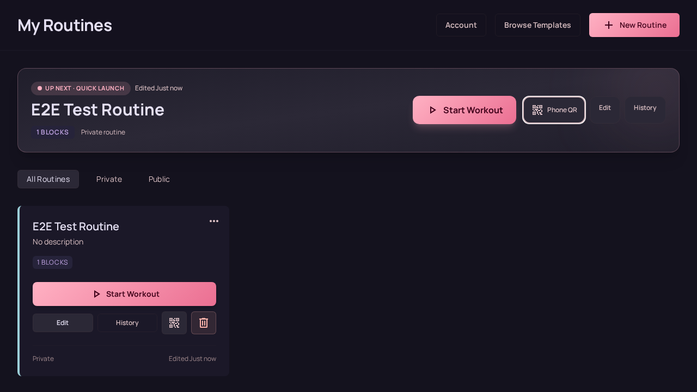
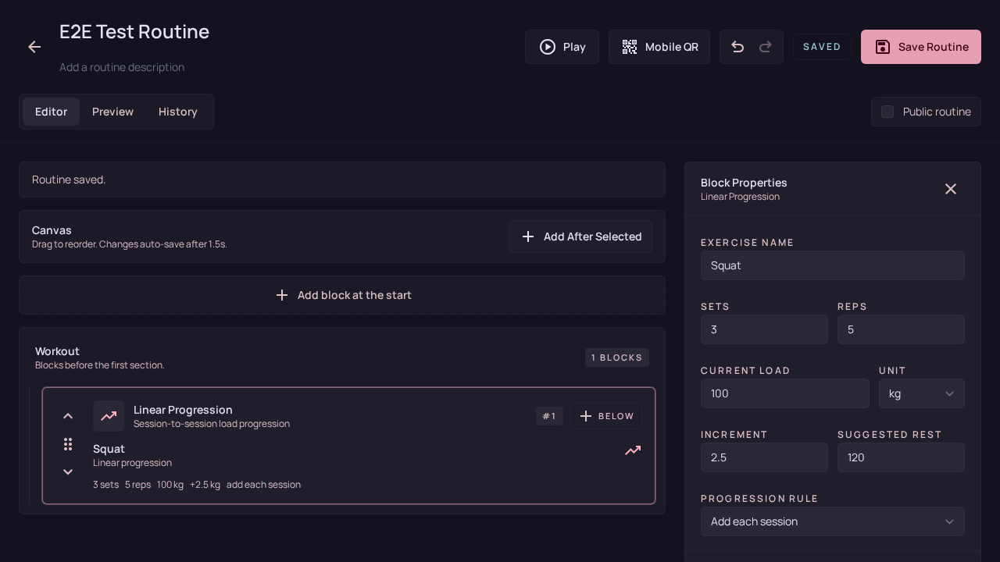
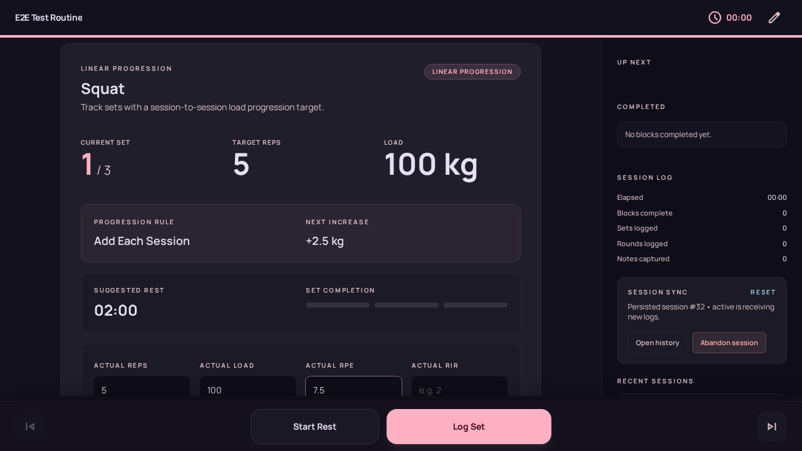
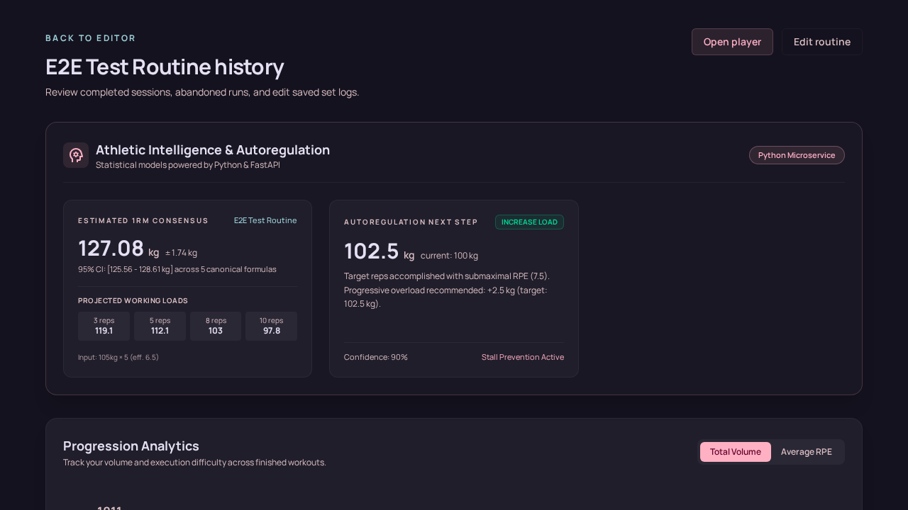
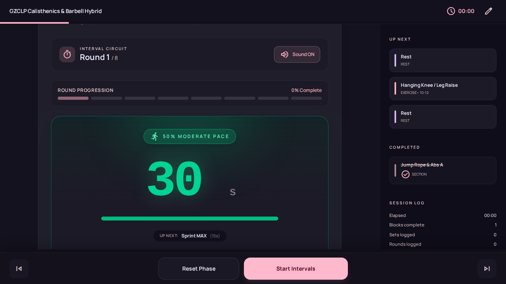

# RepEngine

[](https://github.com/momarinho/repengine/actions/workflows/ci.yml)
[](https://github.com/momarinho/repengine/actions/workflows/docker.yml)
[](https://opensource.org/licenses/MIT)

**RepEngine** is an offline-first, high-performance training routine studio and physical gym execution platform. It unifies a reactive web block architect, an asynchronous template clone engine, intelligent progression engines (Linear, Wave, Double Progression), an AI workout architect, and a native Flutter mobile companion designed for zero-latency execution in connectivity-challenged gyms.

Designed around the **Dual-Workflow Architecture**, RepEngine bridges the gap between deep routine programming at a desktop workstation and frictionless, sweat-proof workout tracking on mobile.

---

## 📷 Interface Showcase

| 🖥️ **Web Routine Architect** | 🛠️ **Block Studio & Progressions** |
|:---:|:---:|
|  |  |
| ⚡ **Active Workout Player** | 📊 **Progression Analytics** |
|  |  |
| ⏱️ **Web Audio Interval Timer** | 📱 **Flutter Gym HUD (Kanagawa Dark)** |
|  | *(Thumb-First Mobile HUD with Local Drift SQLite)* |

---

## 🏗️ System Archite
graph TD
    subgraph Client Tier
        Web[Web Studio - SvelteKit 5 Runes]
        Mobile[Mobile App - Flutter / Riverpod / Drift SQLite]
    end

    subgraph Service Tier
        BFF[Mobile BFF - Dart Frog :8081]
        CoreAPI[Go Fiber Core API :8080]
        Analytics[Python FastAPI Analytics :8000]
    end

    subgraph Shared Core
        SharedPkg[repengine_core - Dart Sports Science & Sync Models]
    end

    subgraph Storage Tier
        DB[(PostgreSQL 16)]
        LocalDB[(Mobile SQLite / Drift)]
    end

    Web -- REST / Auth Cookie --> CoreAPI
    Web -- REST / Insights --> Analytics
    Mobile -- Local Reactive Streams --> LocalDB
    Mobile -.-> SharedPkg
    BFF -.-> SharedPkg
    Mobile -- HTTP / Outbox Sync Push & Pull --> BFF
    BFF -- Upstream Bearer Proxy & Sync --> CoreAPI
    CoreAPI -- pgxpool --> DB
    CoreAPI -- Background Worker --> Queue[Clone Jobs Engine]
    Queue -- Async Clone --> DB
```

---

## 🚀 Key Engineering & Architecture Showcases

### 📱 1. Native Offline-First Mobile Companion (Flutter & Drift)
* **Thumb-Zone Ergonomics**: Built with an Atelier Kanagawa Dark high-contrast theme, thumb-reachable incremental pads (`-5`, `-2.5`, `+2.5`, `+5`), single-tap rep adjustments, and massive set completion targets for sweaty-hand operation.
* **Reactive Local SQLite**: Powered by [Drift](https://drift.simonbinder.eu/) with atomic outbox tables (`routinesTable`, `workoutSessionsTable`, `workoutSetLogsTable`, `syncQueueTable`). All operations complete locally in $< 5\text{ms}$ with zero network dependency.
* **Deterministic Outbox Sync Engine**: When connectivity is available, an automated sync loop flushes pending mutations to the Dart Frog BFF and Go Core via atomic batches, handling network drops, token refresh, and background reconciliation.
* **Zero-Config LAN Auto-Discovery**: Mobile automatically probes the local Wi-Fi subnet (`/24`) in parallel to detect the desktop Docker BFF instance (`repengine_mobile_bff` on port 8081), enabling automatic connection without manual IP entry.

### 🧩 2. Canonical Routine JSON Engine (Studio & Mobile Hub)
* **Unified Schema v1**: Routines are represented by a portable, canonical JSON specification (`schema_version: 1`, `sections`, `blocks`, and embedded `progression` nodes).
* **Cross-Platform Compatibility**: Full 1-click export and import across Web Studio, AI assistant prompts, and Mobile.
* **Defensive Parsing**: Validates required structural keys while gracefully tolerating alternative AI formats (`days`/`exercises` vs `sections`/`blocks`), providing clear validation diagnostics.

### 📈 3. Structured Progression Sub-blocks
* **First-Class Progression Models**: Integrated progression metadata directly into canonical `exercise` blocks, supporting:
  * **Linear Progression**: Configurable load increment (+kg per successful session) with autoregulation adjustments.
  * **Double Progression**: Rep range cycling (`min_reps` to `max_reps`). Reaching max reps across sets increases load and resets reps to the lower bound; otherwise maintains load and advances target reps.
* **Visual Graph Rendering**: The Web Studio renders visually connected progression badges and inline sub-block editors (`BlockExercise.svelte`), eliminating detached legacy nodes while preserving backwards compatibility.

### 📊 4. Native SVG Analytics Engine (Zero Bloat)
* **Custom Vector Charts**: Built a native SVG-based chart renderer using Svelte 5 runes (`$derived`, `$state`) to compute coordinate projection scales dynamically on the client.
* **Zero Dependencies**: Completely avoids loading heavy chart libraries (like Chart.js or D3), keeping the web bundle ultralight.
* **Interactive Tooltips**: Supports mouse tracking to trigger tooltips displaying precise workout volume and RPE progression.

### 🔄 5. In-Memory Transactional Undo/Redo
* **State Snapshot Stack**: Implemented a localized state manager in the Svelte 5 editor storing deep-cloned snapshots of routine blocks.
* **Shortcut Bindings**: Intercepts keyboard events for `Ctrl+Z` / `Cmd+Z` (Undo) and `Ctrl+Y` / `Cmd+Y` / `Ctrl+Shift+Z` (Redo).
* **Visual Stack Depth**: Polished, reactive action buttons in the workspace header that enable/disable dynamically based on history depth.

### 🛡️ 6. Concurrency, Advisory Locks & Data Integrity
* **Optimistic Concurrency Control**: Edit conflicts in the block editor are prevented using timestamp comparisons (`updated_at`). Conflicting updates are rejected with `409 Conflict`, returning the server timestamp for reconciliation.
* **PostgreSQL Advisory Locks**: Schema migrations run automatically at boot via an embedded file system (`go:embed`), serialized across multiple application instances using transactional advisory locks.
* **Relational Hardening**: Strict database schema constraints (`CHECK` blocks, cascading foreign keys, unified metrics) maintain raw entry history while calculating normalized columns for progression engines.

### ⏱️ 7. Real-Time Web Audio Interval Engine
* **Zero-Dependency Synthesizer**: Built a native Web Audio API sound generator that dynamically creates audio cues (3-2-1 countdown beeps at 600Hz, sprint chimes, rest alerts, and victory chords) without external audio asset downloads.
* **Hands-Free Multi-Phase Execution**: Automatically parses interval protocols (`30/15/15`, Tabata `20/10`), cycling through phases, announcing switches, auto-logging completed rounds, and progressing hands-free.
* **High-Visibility HUD**: Features glowing phase badges, giant tabular countdown typography, round progress pills, audio toggles, and screen wake lock integration.

### 🐍 8. Athletic Intelligence & Sports Science Microservice
* **Statistical 1RM Consensus**: Aggregates 5 canonical formulas (Brzycki, Epley, Mayhew, Wathen, Lombardi) adjusted for athlete RPE / Reps in Reserve.
* **ACWR Fatigue & Injury Prevention**: Calculates Acute:Chronic Workload Ratios via coupled rolling windows and EWMA models to detect non-functional overreaching and optimal training sweet-spots (0.8–1.3).
* **Autoregulation Engine**: Shared core package (`packages/repengine_core`) and Python FastAPI engine evaluating chronological workout sessions to recommend progressive overload (+increment), load maintenance, or periodization cycle resets (-15%).

### 📱 9. Mobile-First Responsive Web Studio & Preview Hub
* **Fluid Routine Previewing**: The Template Preview screen (`/templates/[id]`) and Studio preview tabs feature responsive 2x2 metadata metrics grids and nested block hierarchies, eliminating awkward horizontal scrolling and excessive vertical spacing on mobile screens.
* **Thumb-Calibrated Steppers**: The workout load override screen (`/play`) features auto-scaling stepper controls (`-5`, `-2.5`, `+2.5`, `+5`) that fit seamlessly into compact mobile viewports (320px–430px) alongside single-tap gym controls.
* **Crystal-Clear Auth Modes**: Distinct, dedicated Sign In (`/login`) and Register (`/register`) experiences with segmented navigation, explicit mode headers, and accessible password helpers.
* **High-Contrast Theming & Autofill Resilience**: Atelier Kanagawa palette optimized with standardized `.btn-primary-gradient` tokens, dark/light contrast integrity, and styled `-webkit-autofill` states preventing browser text-color clashes.

---

## 🛠️ Tech Stack

| Domain | Technologies |
|:---|:---|
| **Core API** | Go (1.24+), Fiber, `pgx/pgxpool` (native PostgreSQL driver), JWT, `slog`, Prometheus metrics |
| **Mobile App** | Flutter (3.47+), Dart (3.13+), Riverpod 2, Drift (SQLite), `flutter_test` |
| **Mobile BFF** | Dart Frog, JWT proxy, batch sync reconciliation |
| **Shared Sports Core** | Pure Dart package (`repengine_core`), Autoregulation, 1RM consensus, ACWR, INOL |
| **Web Studio** | SvelteKit (Svelte 5 runes), TypeScript, TailwindCSS, Web Audio API, Screen Wake Lock API |
| **Analytics Microservice** | Python 3.12, FastAPI, Pydantic v2, NumPy, Pytest |
| **Database** | PostgreSQL 16 (Relational Core), SQLite 3 (Mobile Local-First) |
| **DevOps & Containers** | Docker Compose, GitHub Actions, Alpine Linux minimal runtime |

---

## 🏃 Running Locally

### 1. Full Stack with Docker (Recommended)

Starts PostgreSQL, Go Core API, Mobile BFF, Python Analytics, and the SvelteKit Web App:

```bash
docker compose -f docker-compose.dev.yml up --build
```

* **Web Studio**: [http://localhost:3000](http://localhost:3000)
* **Core API / Docs**: [http://localhost:8080/docs](http://localhost:8080/docs)
* **Mobile BFF**: [http://localhost:8081](http://localhost:8081)
* **Analytics Microservice**: [http://localhost:8000/docs](http://localhost:8000/docs)

### 2. Running Flutter Mobile

From the `mobile/` directory:

```bash
cd mobile

# Run all 74 unit and widget tests
flutter test

# Run linter
flutter analyze

# Launch on connected Android device or emulator
flutter run

# Build production release APK
flutter build apk --release
```

To install the release APK directly to a connected device via ADB:

```bash
adb install -r build/app/outputs/flutter-apk/app-release.apk
```

---

## 🧪 Validation & Tests

### Backend Unit Tests (Go)
```bash
cd api
CGO_ENABLED=0 go test ./...
```

### Shared Core Tests (Dart)
```bash
cd packages/repengine_core
dart test
```

### Mobile Tests (Flutter)
```bash
cd mobile
flutter test
```

### Frontend Unit Tests (Node native runner)
```bash
cd web
npm test
```

### Frontend Syntax & Type Checks (SvelteKit)
```bash
cd web
npm run check
```

### End-to-End Tests (Playwright)
```bash
cd web
npx playwright test
```

---

## 📄 License

This project is open-source software licensed under the [MIT License](LICENSE).
